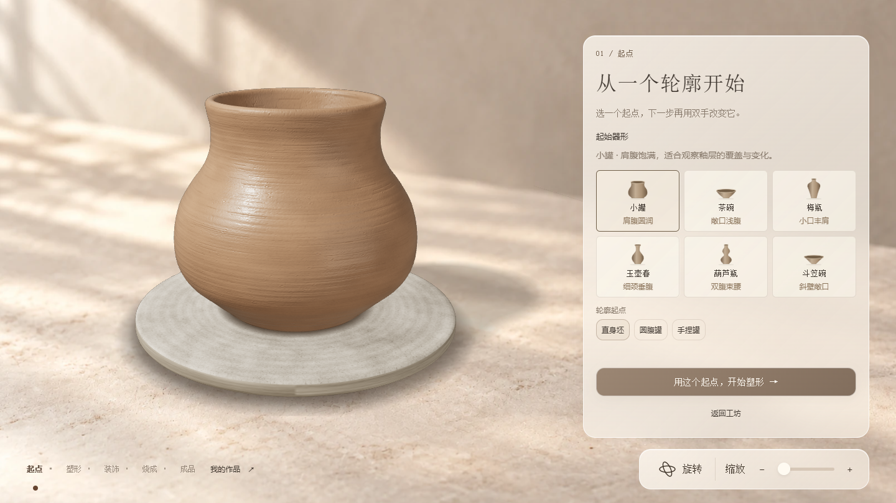
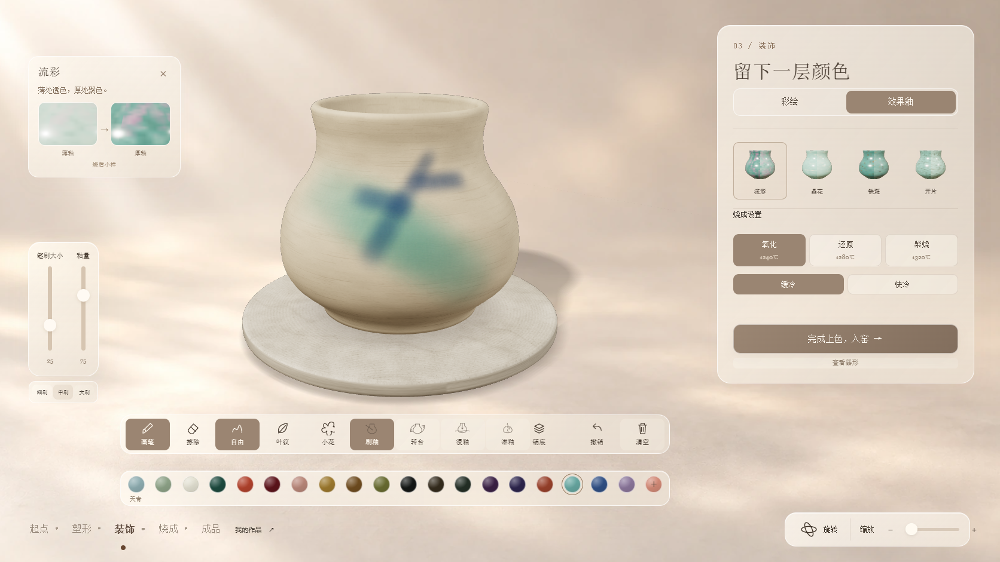
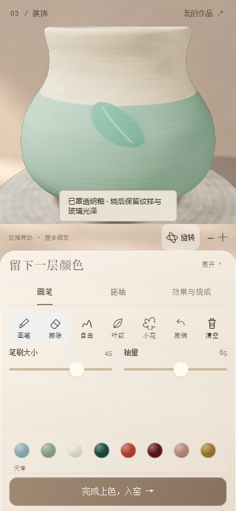
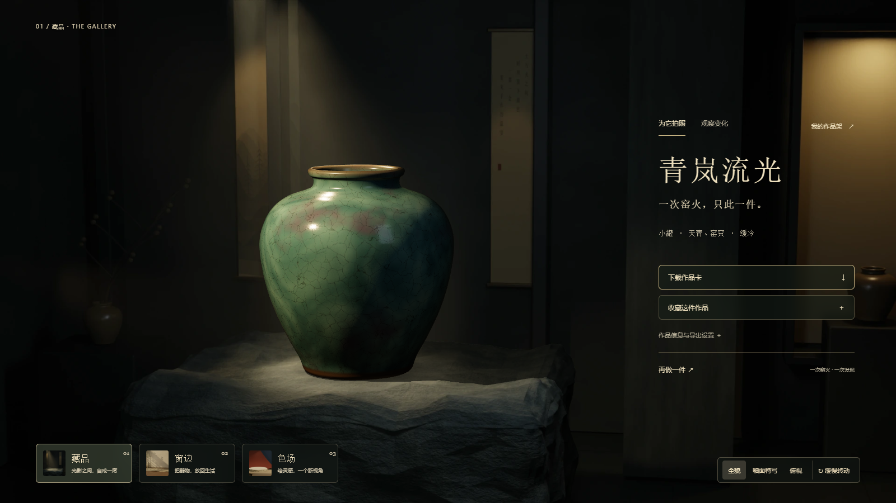
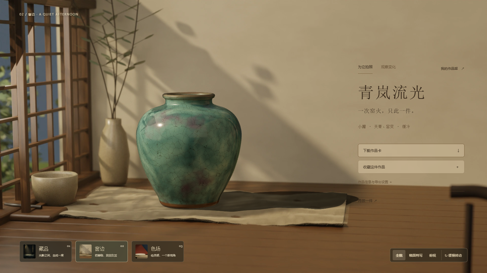
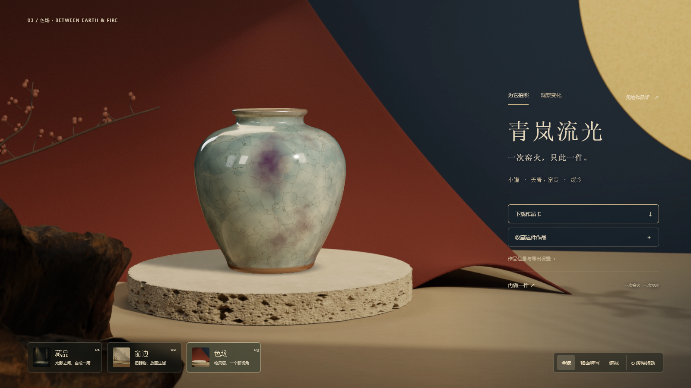
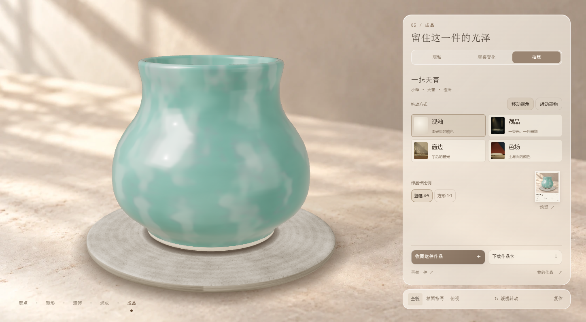

# 窑变陶艺工坊

从一团湿泥到一件独有的陶器：选择器形、自由塑形、彩绘施釉、烧成冷却，再为成品拍照和收藏。适用于科普平台嵌入，界面与导出卡片不带品牌顶栏。

**项目已完成，本仓库保存最终交付与制作源码。**

## 下载与使用

- **懂了鸭上传版：[platform/index.html](platform/index.html)**，约 9.22 MB，图片、脚本、模型全部内嵌。上传这一个文件即可。
- **完整离线版：[dist/pottery-studio.html](dist/pottery-studio.html)**，约 33.25 MB，保留原始资源精度。
- 下载时打开文件页面，点击 **Download raw file**。两版均可直接用现代浏览器打开，无需安装依赖。
- 收藏保存在当前浏览器和当前网址下，文件预览与线上网址之间不会自动同步。

## 制作与观察



六种器形起点：小罐、茶碗、梅瓶、玉壶春、葫芦瓶、斗笠碗。起点选择与塑形分开，支持整圈推拉、局部手捏、压痕、抚平、拉高、撤销和重置。二维光影背景配合实时三维器物，避免制作页加载整个三维房间。



笔刷支持柔边叠色，施釉包含刷釉、转台、浸釉和淋釉。流彩、晶花、铁斑、开片以实际算法生成材料小样；氧化、还原、柴烧与冷却方式参与烧成效果。随选讲解卡提供简短说明与图示。工艺参数用于互动科普表达，并非真实配方或窑炉控制方案。



手机使用触控工具面板，单指制作、双指旋转缩放；小屏参数区局部滚动，横竖屏切换保留作品。

## 成品摄影与作品卡







烧成后进入摄影，可在藏品、窗边、色场及中性观釉环境中观察器物。支持细看釉面、对照烧前烧后、调整光照与有限取景，收藏列展示透明背景器物。



作品卡提供实时小预览、点击放大、命名、4:5 / 1:1 比例与 PNG 导出。

## 开发、验证与交付记录

源码入口为根目录 `index.html`，运行 `npm start` 后打开 `http://127.0.0.1:4173/`。Three.js 已随仓库提供。

```sh
npm run build:single
npm run prepare:platform
npm run build:platform
```

平台资源准备使用 Python、NumPy 和 Pillow；浏览器测试使用 Playwright 与 Edge。详细说明见 [平台交付说明](docs/platform-delivery.md)、[验证记录](QA.md)、[开发过程记录](docs/development-history.md)。关键检查报告已保存在 [docs/verification](docs/verification)。

平台版通过 Node/Python 静态审计，并在 1440×810、1024×768、768×1024、390×753、352×447 检查布局；另验证触控、收藏、作品卡预览导出与 WebGL 恢复。验证属于桌面浏览器模拟，实体手机和平台线上嵌入需以实际环境为准。

目录：`assets/` 为运行素材，`blender/` 为美术工程与生成脚本，`design-concepts/` 为设计参考，`tests/` 为验证脚本。测试中间图片、缓存和 Blender 自动备份不进入最终交付。

[最终交付记录](docs/final-delivery.md)。

