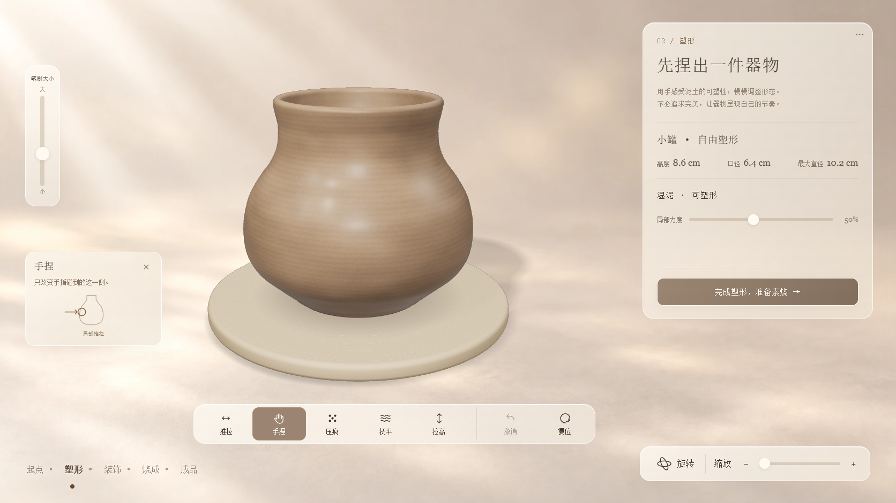
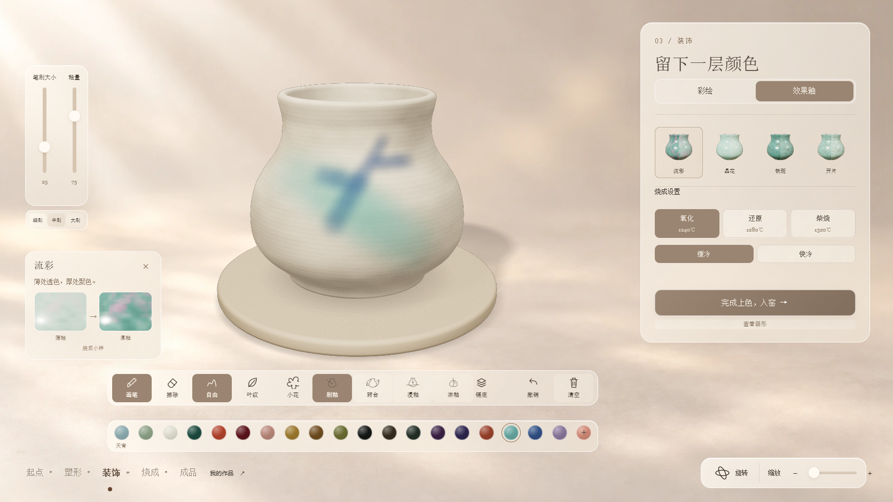

# 窑变陶艺工坊 · 单 HTML 版

`single-html` 分支发布当前完整体验。运行文件为 [index.html](./index.html)，约 32.3 MB；脚本、模型、贴图、拍照背景和烧成 Worker 均已内嵌。

## 使用

1. 下载 [index.html](https://github.com/404-NOT-FOUND-ERROR/Kiln-Fired-Pottery-Studio/raw/refs/heads/single-html/index.html)，保存为 HTML。
2. 用 Edge 或 Chrome 打开，离线即可体验。
3. 也可将此文件作为网站首页部署，或通过 iframe 嵌入平台。

收藏保存在当前浏览器中；作品照片与烧前、烧后对照图可导出为 PNG。

## 完整流程

选择起点 → 塑形 → 自动修足、干燥与素烧 → 彩绘 / 施釉 → 烧成 → 拍照 / 观察 → 收藏。

- 六种起始器形，支持手捏、推拉、压痕、抚平、拉高、旋转、缩放和撤销。
- 笔刷、转台、浸釉、淋釉、纹样、擦除、铺底、颜色选择和透明罩釉。
- 流彩、晶花、铁斑、开片效果，烧成与冷却选项。
- 随选讲解卡，材料小样随颜色及工艺更新。
- 藏品、窗边、色场三种拍照背景；观察变化、图片导出及收藏恢复。

制作界面使用二维光影背景、实时器物和紧凑毛玻璃控件。

## 实际界面

## 验证与版本

2026-10-09 版本。六种横屏尺寸检查主要控件无需纵向滚动；离线 file:// 下完整制作、Worker 烧成、三场景拍照、图片导出、收藏恢复、触摸与键盘操作通过。

单文件 SHA-256：
`2208a5e88e654ddadc180fe36a453ee15d94b87913826a9b4849462b585ac347`

项目采用 MIT 许可。Three.js 许可已内嵌在 HTML 中，并保留在 [vendor/THREE-LICENSE.txt](vendor/THREE-LICENSE.txt)。
