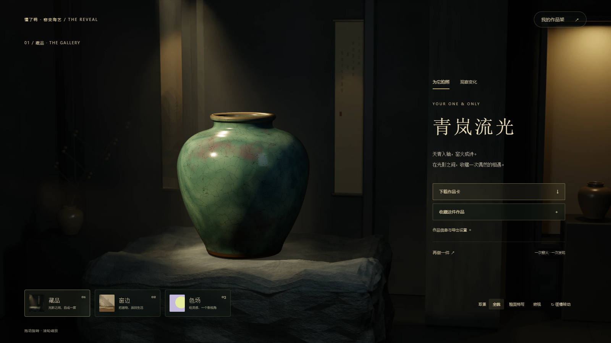
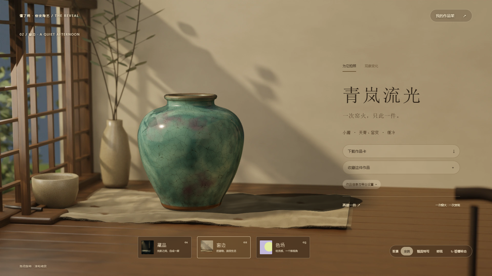
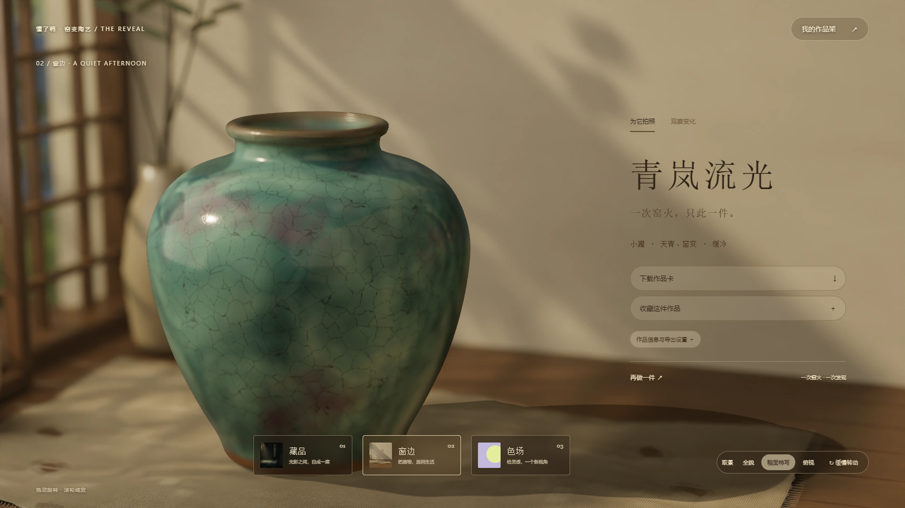
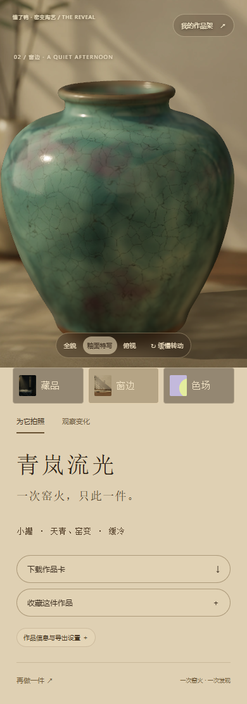

# 懂了鸭 · 窑变陶艺工坊

通过三维施釉、窑火揭晓与作品对照理解陶艺的可交互原型。

## 体验

选择梅瓶、茶碗或小罐 → 自由刷釉、转台刷釉、浸釉或淋釉 → 选择烧成组合预设 → 出窑揭晓 → 观察或拍照。

出窑后包含：

- **藏品 / 窗边**：Blender 场景底图、实时三维陶器、现场环境反射与动态阴影。藏品使用石台与暗色展厅；窗边使用午后木窗、麻布、旧木桌和枝叶投影。固定机位，拖动旋转器物；色场保留原版布景。
- 全貌、釉面特写、俯视机位，以及可选的缓慢转动。窗边特写使用独立的斜侧机位与实时景深。
- 中性光照下切换烧前釉层、本次烧成、仅改变冷却条件的对照。
- 命名作品，导出 1200×1500 或 1200×1200 PNG 作品卡、1600×1120 冷却对照卡。
- IndexedDB 作品架：保存名字、场景、原始釉层与烧成参数，刷新后可重新打开与拍摄。
- 保留器形、釉色、窑火小记；响应式布局、可跳过烧制动画、遵循系统减少动态效果设置。

首页「先看一件成品示例」可直接进入展示区。

## 界面截图与本次更新

以下截图来自实际运行的网页，拍摄于 2026-10-05。

### 藏品展厅



暗色展厅、石台和局部照明突出器物。Blender 场景与网页三维陶器共用经过校准的机位；拖动旋转陶器时，展厅保持固定。首页、施釉流程和作品架使用同一套墨绿与米金界面风格。

### 窗边全貌



午后木窗、灰泥墙、麻布和旧木桌组成暖色场景。窗外改为分层的独立枝叶，以柔和虚化呈现远景；枝叶在墙面和陶器上投射斑驳光影。细化木料反光、麻布织纹、灰泥起伏和陶杯颗粒，并修复插枝从小花瓶颈部侧面穿出的问题，让枝条从瓶口内收拢伸出。

### 釉面特写



特写采用独立的斜侧稍俯机位，对焦于陶器前肩的釉面。背景、远处口沿及器身其他位置按距离逐渐虚化；实时陶器继续支持旋转，导出的作品卡也保留景深。桌面只接收陶器自身的实时投影，避免叠加底图已有的叶影。

### 手机界面



手机上将画面、场景选择和作品信息上下排列，保留全貌、特写、俯视、收藏和下载操作。390、768、1024 像素宽度已检查；旋转、场景切换、收藏恢复和 PNG 导出验证见 [QA.md](QA.md)。

## 本地运行

需要 Node.js，无需安装 npm 依赖：

```sh
node serve.cjs
```

打开 <http://127.0.0.1:4173>，或 <http://127.0.0.1:4173/?preview=1> 直接查看示例。窗边入口为 <http://127.0.0.1:4173/?preview=1&scene=living>。

本版使用 ES modules，应通过 HTTP 服务运行，不能继续双击 HTML 使用。Three.js 0.161.0 及附加模块已放在 vendor/，启动后无需访问外部 CDN。静态发布须包含 index.html、exhibition.js、exhibition.css、museum-assets.js、museum-stage.js、museum.css、living.css、living-optics.js、studio-theme.css，以及整个 vendor/、assets/museum/ 和 assets/living/。Blender 源文件不需要随网站发布。

## 文件

- index.html：原有选择、施釉、烧成逻辑，以及新成品页面入口。
- exhibition.js：三维布景、观察对照、PNG 导出、本地收藏。
- exhibition.css：展示区、作品架、揭晓动画与移动布局。
- studio-theme.css：首页、制作区、引导和作品架共用的墨绿与米金视觉样式。
- museum-assets.js / museum-stage.js / museum.css：素材读取、展厅相机与遮挡阴影、沉浸布局。
- assets/museum/：导出的网格、釉面贴图、两组展厅底图与 HDR 反射探针。
- living.css / living-optics.js / assets/living/：暖色窗边界面、三组场景图、实时景深、桌面和麻布阴影接收网格、树叶投影网格、现场 HDR。
- blender/museum/：可编辑场景、渲染、导出及压缩脚本。
- blender/living/：窗边可编辑场景及构建、渲染、导出和压缩脚本。
- serve.cjs：只监听本机的静态服务器，可用 PORT 环境变量指定端口。
- preview.png：出窑展示预览。

## 模型边界

本项目是艺术化工艺科普原型，不是陶瓷配方或烧成预测器。颜色由绘制纹理与规则变换产生；温度与气氛是组合预设。缓冷不保证结晶，快冷不保证透明；真实结果取决于釉料、坯体、气氛和温度曲线等。小罐使用 Blender 导出的同一网格与弧长 UV 完成施釉、展示与收藏恢复；梅瓶和茶碗保留原有程序器形。示例小罐使用烘焙釉色，用户作品使用自己的绘制颜色。

藏品、窗边机位与底图同步裁切，支持全貌、特写、俯视和有限缩放；不支持自由绕房间行走。釉面细节为共用的艺术化材质。实时光照与 Cycles 离线渲染仍有差异。

收藏只属于当前浏览器、当前网站来源；清除网站数据、改变端口或换浏览器不会迁移这些作品。下载作品卡可保留成片，但图片不包含可编辑的三维数据。

## 验证

使用本机 Edge 检查完整施釉与出窑、三种场景、作品卡及对照卡导出、收藏后刷新恢复、恢复后再做一件、手机布局与控制台错误。详细记录见 QA.md。

## License

[MIT](LICENSE)。Three.js 许可证保留于 [vendor/THREE-LICENSE.txt](vendor/THREE-LICENSE.txt)。
